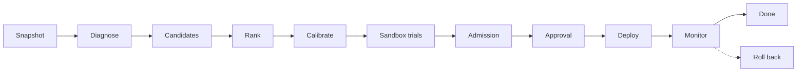

# AI-Driven Autonomous NoSQL Query Optimization Framework

This project watches a MongoDB database, works out which indexes its slow queries are missing, tests each candidate on a separate copy of the data, and changes the real database only when the measurements back it up. A local language model (through Ollama) helps with two steps, diagnosis and ranking. It can suggest things, but it never decides and never runs anything against the database.

I built it as my NoSQL Databases (BCSE406L) project at VIT.

## Why

Query patterns drift over time. An index that made sense last year stops matching what the application actually runs, and nobody re-checks every collection against live traffic. The usual way you find out is that something is already slow in production.

Adding indexes everywhere isn't the fix either, since every index costs memory, disk and write time. The real job is picking the few that pay for themselves under your actual traffic and showing that they do. This project automates that loop and keeps a record of every change so it can be undone.

## How a run works

Every optimization is a "run", and every run goes through the same steps:



1. The worker freezes the current query shapes and index stats into a snapshot. Everything later in the run points back to it.
2. The model reads the snapshot (with query literals removed) and writes a diagnosis. Each finding has to cite a real query shape or piece of evidence from the snapshot, otherwise it's thrown out.
3. Candidate indexes come from fixed rules based on each query's structure (equality fields, then sort, then range). The model doesn't write them.
4. The model puts the candidates in order. It can't add, rename or drop any.
5. Each candidate is tested on the sandbox replica in paired trials, with the order alternated so drift on the machine can't favour one side.
6. A candidate is admitted only if a paired bootstrap (10,000 resamples, one-sided 95% bound) shows at least a 5% gain on the run's main metric, nothing protected (p95, p99, write latency) gets more than 3% worse, and both sides returned identical results.
7. A second person approves it, the worker creates the index, and it keeps timing the real queries afterwards. If latency jumps or errors show up, it rolls the change back.

## Safety rules

- Approval is the default. The person who started a run can't approve it, approvals expire after 15 minutes, and an approval is tied to the exact evidence it was given for.
- There is an autonomous mode, but it only covers two low-risk changes (creating an index and setting a query hint), uses stricter thresholds, and can be switched off with one setting.
- The worker can only do a short list of things on the target: list collections and indexes, create or drop an index, and read or set query settings. Model output has no path to an arbitrary database command.
- Every production change goes into a SHA-256 hash-chained ledger in PostgreSQL along with the exact command that reverses it. Rollback only touches indexes the ledger shows the optimizer created. If an index was changed by hand, rollback stops and says so instead of guessing.

## Stack

- FastAPI + PostgreSQL 17 (with pgvector) for the control plane
- A background worker that runs the pipeline from durable jobs (leases, heartbeats, retries, crash recovery)
- MongoDB 8.0 replica sets: one monitored target and one sandbox
- Ollama on the host machine (`gemma4:e4b` by default, `gemma4:e2b` on machines with less memory) plus `embeddinggemma` for embeddings
- A React console
- Docker Compose for all of it

Passwords are hashed with Argon2, sessions use JWTs with refresh rotation, stored secrets are encrypted with AES-256-GCM, and MongoDB credentials only ever live in the worker.

## Running it locally

The dev setup targets an Intel Mac with Docker Desktop and Python 3.12. See [`docs/ENVIRONMENT_COMPATIBILITY.md`](docs/ENVIRONMENT_COMPATIBILITY.md) for details.

```bash
./scripts/bootstrap.sh                 # creates the project venv in nosql/
source nosql/bin/activate

# dev-only secrets (git-ignored)
mkdir -p .secrets
python scripts/generate_master_key.py --output .secrets/control_plane_master_key
python scripts/generate_mongodb_keyfile.py --output .secrets/mongodb_replica_keyfile
export JWT_SIGNING_KEY=$(python -c 'import secrets; print(secrets.token_urlsafe(48))')

make dev                               # postgres, both mongo replica sets, api, worker, console
make user EMAIL=ops@example.com ROLE=OPERATOR
make user EMAIL=lead@example.com ROLE=APPROVER
make dev-workload                      # seeds commerce.orders and runs slow reads for 2 minutes
```

Keep `JWT_SIGNING_KEY` set to the same value for every later `docker compose` command, or the stack won't start.

Then open http://localhost:5173 and sign in as the operator:

1. Add a target `orders-production` with connection label `mongo-monitored`, and a second target `orders-sandbox` with label `mongo-evaluation`.
2. On `orders-production`, pick the sandbox, allow `commerce.orders`, and wait for the setup checklist to go green. The worker collects telemetry every 30 seconds.
3. Start a run. When it reaches approval, sign in as the approver (it has to be a different user) and approve it from Approvals.

If Ollama isn't running, set `AI_PROVIDER=deterministic`. Runs still work; the diagnosis just has no findings, and candidates come only from the rules.

On a CPU-only machine a diagnosis takes a few minutes. If it times out, raise `AI_TIMEOUT_SECONDS` for the worker or switch `OLLAMA_CHAT_MODEL` to `gemma4:e2b`.

## Where the database credentials live

They never reach the API or PostgreSQL. The worker reads a JSON file (`TARGET_CONNECTIONS_FILE`, by default [`infra/dev/target_connections.json`](infra/dev/target_connections.json)) keyed by each target's connection label:

| Role | Used for |
| --- | --- |
| `observer_uri` | read-only telemetry, capability checks, copying data to the sandbox, monitoring |
| `executor_uri` | `createIndex`, `dropIndex` and query settings on the monitored target only |
| `sandbox_uri` | rewriting the disposable sandbox replica |

The console only ever sees the label names and roles, never the URIs.

## The console

- **Overview**: runs in progress, approvals waiting, stalled runs and why they stalled
- **Targets**: setup checklist, sandbox choice, allowed collections
- **Runs**: the step-by-step progress, what happened in plain words, the slow query shapes, the AI diagnosis, each tested index with its trial chart and admission evidence, deployment, monitoring and rollback
- **Approvals**: pending requests with an expiry countdown
- **Ledger**: every production change, with a tamper check
- **System**: worker health, AI model, connections

## Tests

```bash
make test             # backend tests (the live MongoDB tests need `make dev` running)
make acceptance
make verify-local     # the whole thing against real Docker: stack, live Mongo, suite, frontend
cd frontend && npm test && npm run build
```

A 60-second load soak served 4,444 API requests with no failures at a p95 of 90.8 ms. The details are in [`docs/PRODUCTION_READINESS.md`](docs/PRODUCTION_READINESS.md).

There are two other Docker profiles: `make replica-test-env` brings up the replica-set test stack, and `make paper-env` brings up the stack used for the benchmark experiments.

Only use the `nosql/` virtual environment for this project. Don't install its packages into the system Python.

## Docs

| File | What's in it |
| --- | --- |
| [`docs/ARCHITECTURE.md`](docs/ARCHITECTURE.md) | Components and data flow |
| [`docs/SAFETY_CONTRACT.md`](docs/SAFETY_CONTRACT.md) | What the optimizer is and isn't allowed to do to a database |
| [`docs/BENCHMARKING.md`](docs/BENCHMARKING.md) | Admission statistics and benchmark method |
| [`docs/THREAT_MODEL.md`](docs/THREAT_MODEL.md) | Threats and mitigations |
| [`docs/API.md`](docs/API.md) | Control-plane API |
| [`docs/RUNBOOK.md`](docs/RUNBOOK.md) | Running and operating it |
| [`docs/DATABASE_ADAPTER_CONTRACT.md`](docs/DATABASE_ADAPTER_CONTRACT.md) | Adding another database |
| [`artifacts/experiments/README.md`](artifacts/experiments/README.md) | Which experiment files are the real results |

## License

MIT, see [`LICENSE`](LICENSE).
