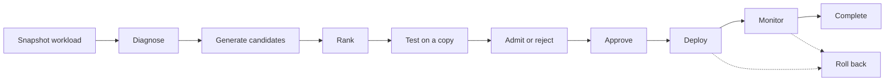

# AI-Driven Autonomous NoSQL Query Optimization Framework

A system that watches a MongoDB deployment, works out which indexes its queries need, tests those changes against a copy of the data, and only touches the real database when the measurements justify it. A local language model handles two steps of the process. Everything else is deterministic, so the model can suggest but never decide.

## The problem

Query patterns drift. An index that made sense a year ago stops matching what the application actually runs, and nobody re-audits every collection against live traffic on a schedule. Slow queries, unused indexes and missing ones pile up, and the usual way to find out is that something is already slow in production.

More indexes isn't the answer either, since each one costs memory, disk and write time. The task is picking the few that pay for themselves under the traffic you really have, and proving it. This project automates that loop and keeps a record that makes every change reversible.

## How it works

Each optimization is a run that moves through the same stages every time.



A run begins by freezing the database's current query shapes and index statistics into a snapshot. That snapshot becomes the evidence for everything that follows.

The model is used for two things only: diagnosing what's wrong, and ranking the fixes. When it diagnoses, it can only point at evidence it was actually given. If it can't cite something real, it reports nothing. It never invents metrics, queries or commands.

The fixes themselves aren't written by the model. Candidate indexes are generated by fixed rules from the structure of each query, following the usual equality, sort, range ordering. The model only gets to put those candidates in order, and it can't add, rename or remove any.

Candidates are then run against an isolated copy of the data, never production, and measured before and after. A candidate is admitted only if the measured improvement clears a set threshold, and certain metrics are never allowed to get worse no matter how good the rest looks. The statistical bar (warm-up, sample size, confidence) depends on whether the run is a quick smoke test, an autonomous run or a publication-grade experiment.

## Approval and safety

A human approves each change by default. An approval is tied to the exact evidence it was given for, so if the diagnosis changes afterwards, the approval is no longer valid. Approvals also expire, so an old sign-off can't be reused later.

A fully autonomous mode exists, but it's narrow. It skips human approval for just two low-risk kinds of change, creating an index and adding a query hint, and a single setting can force human review back on at any time.

The system can only perform a short list of operations on the target database: list collections and indexes, create or drop an index, and read or set a query hint. There's no route from model output to an arbitrary database command.

## What it tracks

- Query shapes and index statistics, captured as a snapshot at the start of every run
- The evidence behind each diagnosis, so every finding can be traced back to real data
- Measured before-and-after results for every candidate tested
- Every approval, and whether it's still valid
- A tamper-evident ledger of every change made to the real database, with the state before and after, the change itself, and the exact action that reverses it
- The outcome of each candidate over time: whether it was admitted, how it performed after deployment, and whether it was rolled back
- Post-deployment health and shifts in the workload

## Learning from history

Past outcomes feed back in. When ranking candidates, the system looks at similar situations it has seen before and moves up the kinds of changes that were admitted in those cases. This only changes the order of candidates that already exist. It never adds candidates or loosens any of the checks.

## Rollback

Every change is recorded alongside its inverse, so undoing it is a matter of applying that inverse. If a safe reversal can't be guaranteed, the run says so and is marked as blocked from rollback rather than reporting that everything is fine.

## Stack

FastAPI and PostgreSQL for the control plane, a background worker for the pipeline, MongoDB as the target, a locally hosted model through Ollama, and a React dashboard for runs, targets, workloads and approvals. It runs under Docker Compose.

## Engineering details

- **Durable orchestration.** Runs and jobs live in PostgreSQL. Workers claim jobs with leases and heartbeats, retry with backoff, and recover after a crash from persisted state. One PostgreSQL advisory lock per target guarantees a single mutation at a time.
- **Statistical admission.** Each candidate is measured in paired, order-alternated trials on a physical copy of the monitored data. It is admitted only if a deterministic paired bootstrap (10,000 resamples, one-sided 95% bounds) shows at least a 5% gain on its declared primary metric and every protected metric passes its non-regression bound.
- **Tamper-evident ledger.** Every production change is appended to a SHA-256 hash-chained ledger in PostgreSQL together with its exact inverse, and rollback only touches indexes the ledger proves the optimizer created.
- **Security.** Argon2 password hashing, JWT sessions with refresh rotation, AES-256-GCM for stored control-plane secrets, and redaction of query literals before anything reaches logs or the model.
- **Experience memory.** Past outcomes are stored as pgvector embeddings and used only to reorder existing candidates, never to add candidates or relax a check.
- **Load qualification.** A 60-second soak served 4,444 API requests with zero failures at a p95 of 90.8 ms, with bounded PostgreSQL and MongoDB connections and no leaks after cleanup ([`docs/PRODUCTION_READINESS.md`](docs/PRODUCTION_READINESS.md)).

## Quick start

The development environment targets an Intel macOS host with Docker and a project-local `uv` (see [`docs/ENVIRONMENT_COMPATIBILITY.md`](docs/ENVIRONMENT_COMPATIBILITY.md)).

```bash
./scripts/bootstrap.sh                       # Python 3.12 environment and checks
mkdir -p .secrets
./nosql/bin/python scripts/generate_master_key.py --output .secrets/control_plane_master_key
./nosql/bin/python scripts/generate_mongodb_keyfile.py --output .secrets/mongodb_replica_keyfile
make dev                                     # PostgreSQL, monitored + evaluation MongoDB, API, worker, dashboard
make test                                    # backend test suite
```

The API listens on `127.0.0.1:8000` and the dashboard on `127.0.0.1:5173`. Operating and production details are in [`docs/RUNBOOK.md`](docs/RUNBOOK.md).

## Documentation

| Document | Contents |
|---|---|
| [`docs/ARCHITECTURE.md`](docs/ARCHITECTURE.md) | Components and data flow |
| [`docs/SAFETY_CONTRACT.md`](docs/SAFETY_CONTRACT.md) | What the optimizer may and may not do to a database |
| [`docs/BENCHMARKING.md`](docs/BENCHMARKING.md) | Admission statistics and benchmark methodology |
| [`docs/THREAT_MODEL.md`](docs/THREAT_MODEL.md) | Threats and mitigations |
| [`docs/API.md`](docs/API.md) | Control-plane API |
| [`docs/DATABASE_ADAPTER_CONTRACT.md`](docs/DATABASE_ADAPTER_CONTRACT.md) | Adding support for another database |
| [`artifacts/experiments/README.md`](artifacts/experiments/README.md) | Which experiment files are authoritative |

## License

MIT. See [`LICENSE`](LICENSE).
